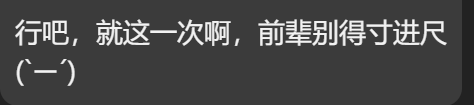
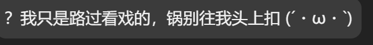

# astrbot_plugin_kaomoji

让 bot 的回复末尾自然带颜文字。

模型只需要在回复末尾写一个 `{{分类键}}` 标记，插件从颜文字库里挑一条替换掉标记——不用把 172 条表情塞进 prompt。

模型只需要在回复末尾写一个 `{{分类键}}` 标记，插件从颜文字库里挑一条替换掉标记——不用把 172 条表情塞进 prompt。

```
前辈别得寸进尺
{{哼}}
        ↓
前辈别得寸进尺 (`ー´)
```

## 效果

私聊（模型给标记，插件替换）：



群聊（同一套规则，不同会话各自生效）：



## 特性

- **26 类 / 172 条**颜文字，按情绪分类（高兴、悲报、无语、震惊、哼、盯……）
- 标记替换：模型选类目，插件抽具体表情，一条回复最多一个
- **兜底**：模型没给标记时，先按关键词、再按语义（embedding）从回复本身判断情绪补一个（可配）
- **流式兼容**：流式输出时在结束后单独补发一条（`streaming_mode=followup`）
- **聊天内增删**：`/kaomoji add|del|list`，管理员即可修改自己的库
- 只装饰 LLM 回复，不碰指令 / 工具输出；和 meme_manager 的 `&&标记&&` 互不干扰

## 安装

1. 把本目录放到 `AstrBot/data/plugins/astrbot_plugin_kaomoji/`
2. 在 WebUI「插件」页重载插件
3. 正常聊天即可；需要向量兜底时确认 AstrBot 里配了 embedding provider

## 配置

| 键 | 默认 | 说明 |
|---|---|---|
| `enable` | true | 总开关 |
| `mode` | auto | auto=模型给标记就替换；keyword=只按正文关键词补；off=关闭 |
| `streaming_mode` | followup | 流式时 followup=结束后补发；off=不处理 |
| `streaming_probability` | 0.5 | 流式补发概率 |
| `remind_in_user_message` | true | 在用户消息末尾追加一句标记提醒 |
| `prompt_categories` | 12 | 注入给模型的分类表条目数 |
| `rule_text` | 空 | 自定义注入规则 |
| `threshold` / `keyword_min_score` | 0.55 / 0.4 | 向量 / 关键词匹配阈值 |
| `append_style` | replace | replace=标记位置直接替换；append=句末追加 |
| `fallback_semantic` | false | 语义兜底（每条多一次 embedding 调用） |
| `semantic_threshold` / `semantic_probability` | 0.5 / 0.7 | 语义兜底阈值与频率 |
| `fallback_keyword` | false | 关键词兜底 |
| `embedding_provider_id` | 空 | 指定 embedding provider，留空自动选第一个 |
| `sessions` | [] | 生效会话白名单（unified_msg_origin），留空=全部 |
| `force_marker` | false | 流式时也注入标记（不推荐，标记会被直接吐给用户） |

## 命令

```
/kaomoji status            状态
/kaomoji cats              列出所有分类及条目数
/kaomoji list 悲报          看某类的条目（带编号）
/kaomoji add 悲报 (T_T)     添加（管理员）
/kaomoji del 悲报 3         按编号删除（管理员）
/kaomoji test 好惨啊完了    测试匹配
/kaomoji preview           看当前注入的规则
/kaomoji stats             使用统计
/kaomoji reload            重载数据文件
/kaomoji rebuild           重建向量索引
/kaomoji off | on          临时开关
```

## 数据与存储

- 数据目录：`data/plugin_data/astrbot_plugin_kaomoji/`
- 首次运行会把插件自带的 `kaomoji.json` 复制过去；之后 `/kaomoji add|del` 直接改这份文件
- 改 `kaomoji.json` 后 `/kaomoji reload` 生效；类目变化会自动重建向量索引（仅一次）

## 已知限制

- 模型对 `{{分类键}}` 的照做率因模型而异（实测约 10%~100%），实际效果很大程度依赖语义/关键词兜底
- 流式模式下只能事后补发一条，不能内联替换（AstrBot 装饰阶段拿不到待发文本）
- 首次构建向量索引需要 embedding provider 可用
- 正经说明、代码块这类回复建议在人格里约束不要加颜文字

## 数据来源

颜文字收集自 X 岛（nmbxd1）颜文字面板与作者私有整理，分类由作者人工标注。颜文字本身为通用网络文本，本库不单独主张版权；如需商用或再分发请自行确认来源条款，也可以直接用 `/kaomoji add|del` 换成自己的库。

## 许可证

[MIT](LICENSE)
